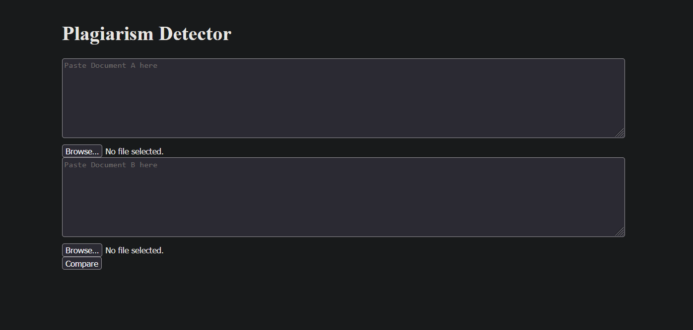
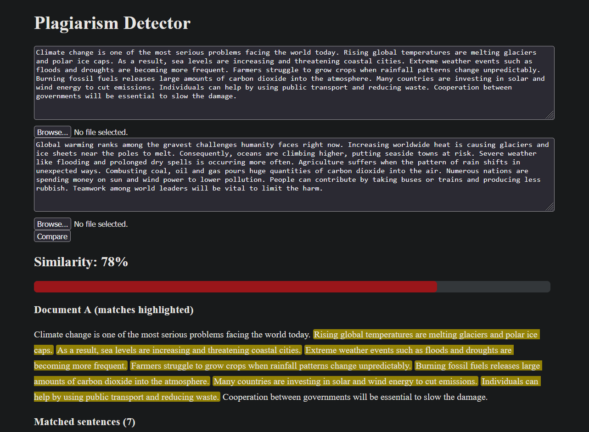
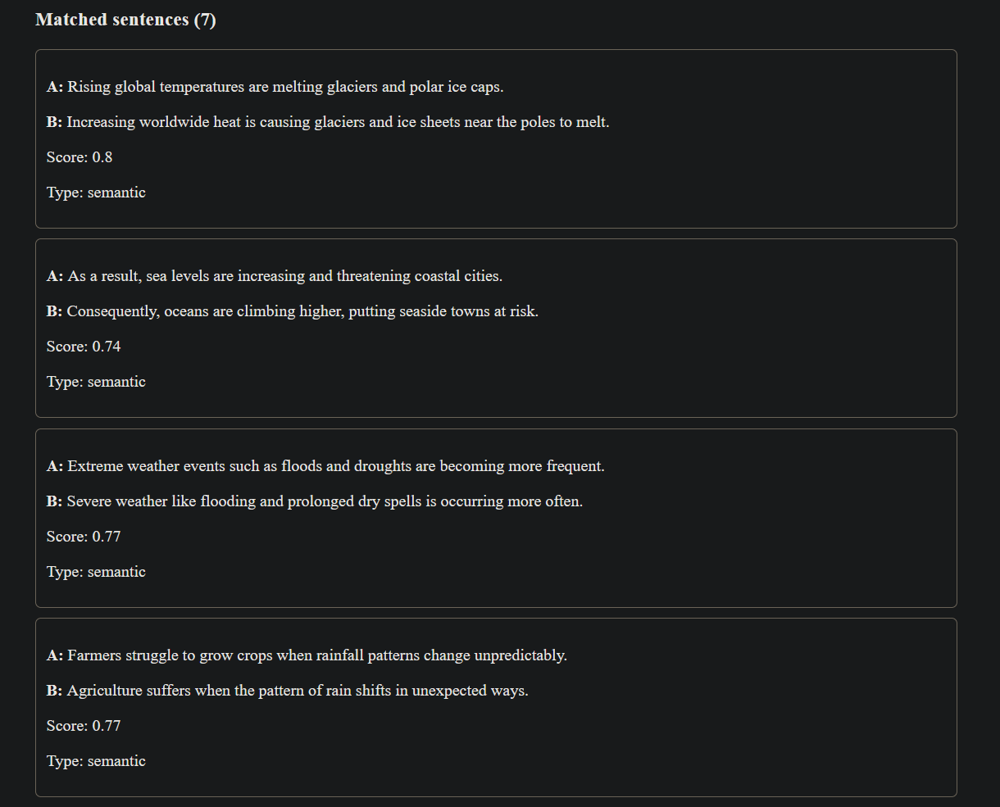
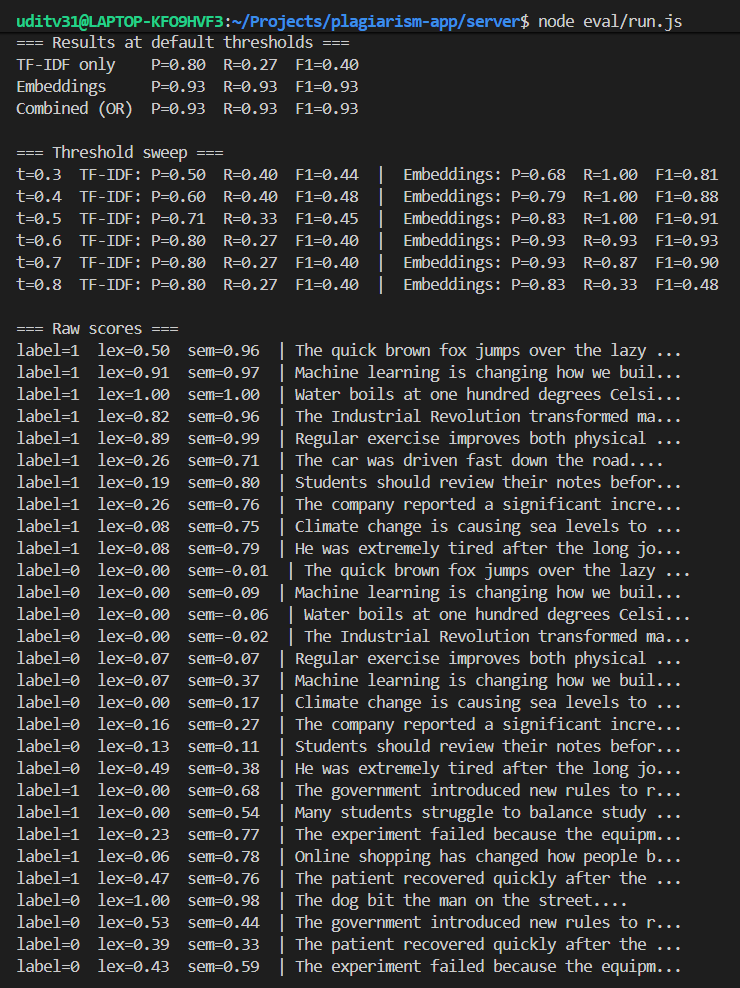

# Semantic Plagiarism Detector

A full-stack web app that compares two documents and flags copied and
paraphrased sentences using TF-IDF cosine similarity and MiniLM sentence embeddings.

## Features
- Compare two documents by pasting text or uploading PDF, DOCX or TXT
- Lexical matching (TF-IDF + cosine) for copy-paste
- Semantic matching (MiniLM embeddings via Transformers.js) for paraphrasing
- Sentence-level highlighting with exact / semantic labels
- Works regardless of sentence order

## Screenshots

# Home


# Paraphrase test result with highlighted matches


# Semantic match card


# Evaluation output


## Tech stack
React (Vite), Node.js, Express, Transformers.js, multer, pdf-parse, mammoth

## How it works
1. Each document is split into sentences.
2. Every sentence gets a TF-IDF vector and a MiniLM embedding.
3. Each sentence in A is compared with every sentence in B using cosine similarity.
4. A sentence is flagged if TF-IDF >= 0.6 or embedding >= 0.6.
5. Overall similarity = flagged sentences / total sentences in A.

## Results

Evaluated on 30 hand-made sentence pairs (15 plagiarized, 15 not).

| Method | Precision | Recall | F1 |
|---|---|---|---|
| TF-IDF only | 0.80 | 0.27 | 0.40 |
| Embeddings only | 0.93 | 0.93 | 0.93 |
| Combined | 0.93 | 0.93 | 0.93 |

Paragraph tests (9-sentence document):

| Test | Result |
|---|---|
| Fully copied | (100 %) |
| Half copied | (44 %) |
| Fully paraphrased | 78% (7 of 9) |
| Unrelated | (0 %) |
| Copied, shuffled | (78 %) |

## Limitations
- Small, hand-made evaluation set
- Ignores word order within a sentence
- Heavy paraphrasing can be missed: in a fully reworded paragraph, 7 of 9 sentences were detected
- Compares only the two documents given, not the web
- Flags for human review; it does not prove plagiarism

## Run locally
```bash
cd server && npm install && node index.js
cd client && npm install && npm run dev
```
Open http://localhost:5173 (the first run downloads the MiniLM model, about 25 MB).

## Future scope
Activity logger, MongoDB history, batch compare, Kafka/Spark streaming